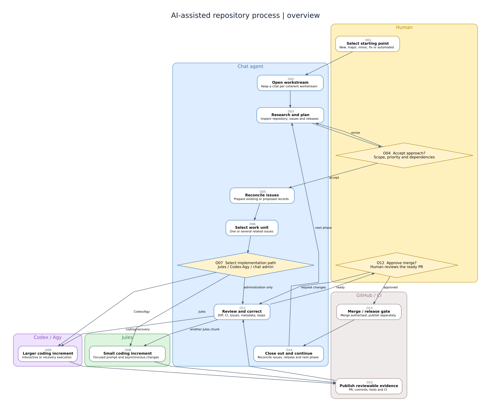
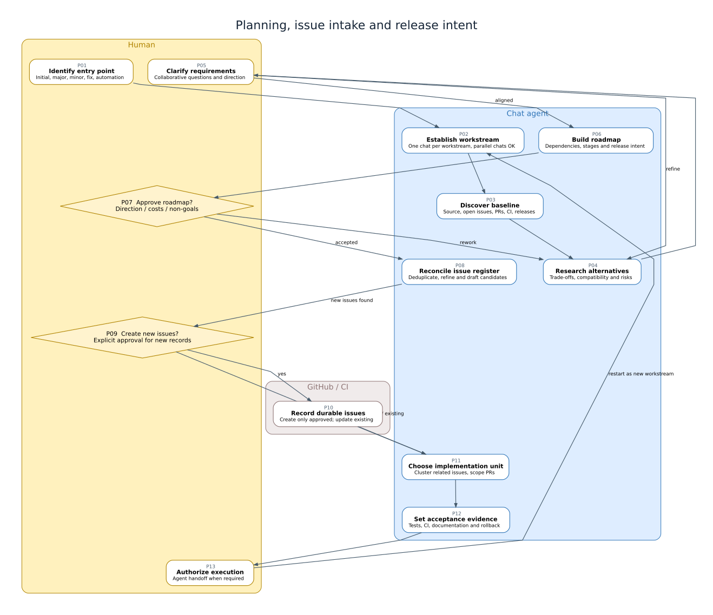
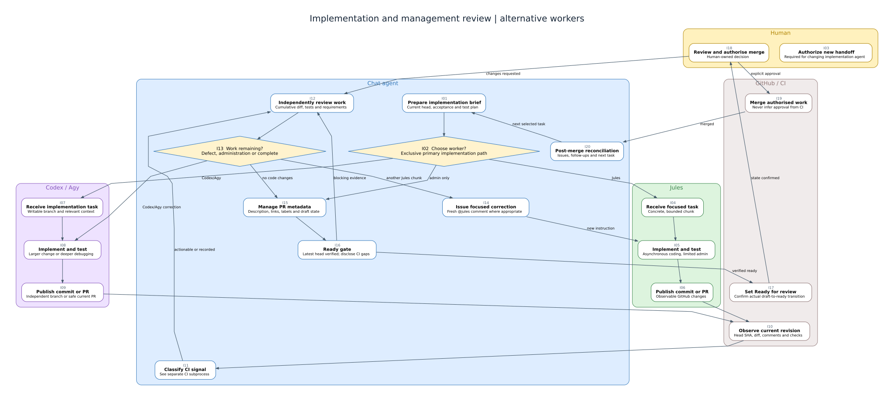
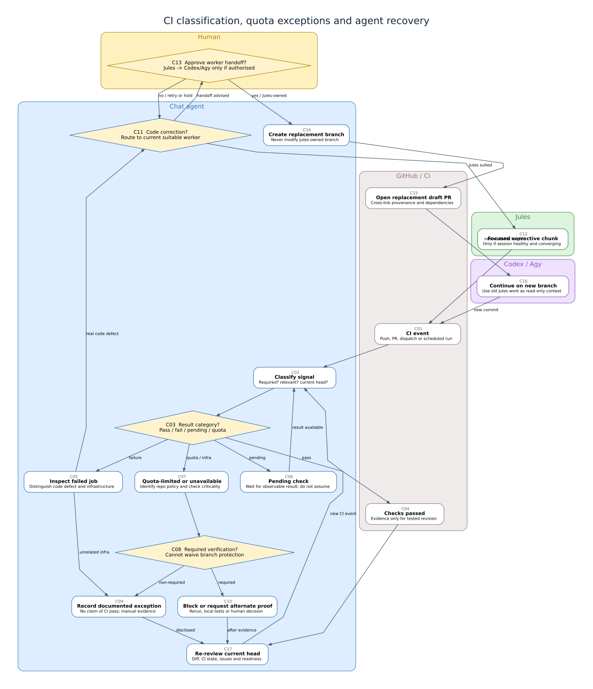

<!-- cspell:words agy bot-authored Graphviz handoff handoffs inspectable kjules non-actionable PRs workstream workstreams -->

Software development with coding agents is not a straight line from a prompt to a pull request. My process begins with different kinds of work, uses a chat-based management agent to preserve intent and reconcile GitHub state, delegates bounded implementation to an appropriate worker, and loops through review, CI, human decisions and follow-up planning.

This is a **process map** rather than a description of a single Jules task. [Managing Jules with a Management LLM](/blog/post/2026/044-jules-management/) remains the more detailed operating reference for Jules-specific behaviour. This article describes the wider process in which Jules is one optional implementation path. Both articles form complementary current guidance; if they conflict on Jules branch ownership and Ready-for-review administration, follow the detailed Jules management article until the conflict is deliberately resolved.

There is normally **one chat conversation per coherent workstream**, not necessarily one per issue or PR. Several workstreams can run independently at once. Within a workstream, Jules **or** Codex/Agy is ordinarily the selected implementation route for a particular increment; parallel PRs and stacked dependencies are deliberate exceptions, not an accidental consequence of drawing branches next to each other.

## Diagram

The diagrams use **Graphviz DOT** as human-editable source and checked-in **SVG** as the rendered artifact. Every box has a unique ID, short header and explanatory text. Diamonds represent decisions rather than activities; arrows give outcomes or reasons. Actors have distinct lanes/coloured groups: **human**, **chat management**, **Jules**, **Codex/Agy**, and **GitHub/CI** (the last is a system, not a decision-making person). The SVG files can be opened at full size; node links lead to the corresponding sections of this article.

[Open full-size overview](overview.svg) · [Edit DOT source](overview.dot) · [Planning nodes](#planning-and-intake-nodes) · [Implementation nodes](#implementation-and-review-nodes) · [CI and recovery nodes](#ci-and-recovery-nodes)

### Subprocess diagrams

#### Planning, intake and roadmap

[Full-size planning diagram](planning.svg) · [DOT source](planning.dot). This subprocess is revisited after a release, after a fundamental scope change, or when a newly discovered issue changes the implementation plan.

#### Implementation, review and PR lifecycle

[Full-size implementation diagram](implementation.svg) · [DOT source](implementation.dot). Jules and Codex/Agy are *alternative* primary workers for the selected increment; a recovery handoff is a controlled transition, not permission to write to a Jules-owned branch.

#### CI classification, quota exceptions and recovery

[Full-size CI and recovery diagram](ci-recovery.svg) · [DOT source](ci-recovery.dot). A quota failure and a failing test are different signals. Neither is a passing test.

To regenerate all SVGs after editing DOT sources, run `bash render-diagrams.sh` from this page bundle with Graphviz installed. Commit both the edited DOT source and resulting SVG in the same PR. Avoid hand-editing the generated SVG; the DOT files are authoritative. Static SVGs render without Mermaid JavaScript or external image generation services. SVG `<a>` links also work when the diagram is opened as a standalone file; normal embedded-image rendering may not expose individual node clicks, so the node catalogue below provides explicit navigable links.

## Starting points and scope

| Entry | Typical additions before implementation | Release interpretation |
| --- | --- | --- |
| **Initial release** | Repository creation; ownership and access; README/licence; initial code; test/CI scaffolding; version and publication plan | First tag/release only after validation and explicit approval |
| **Incremental improvement — major** | Explore architecture/API changes, migrations, compatibility and staged work | Potential breaking/major release; never automatically infer publication |
| **Incremental improvement — minor** | Define additive changes, interactions, tests and documentation | Potential minor release once integrated and approved |
| **Bug fix, issue or feature implementation** | Confirm reproduction/acceptance, identify existing issues, choose narrow PRs | Often patch or no release; classification after actual diff |
| **Automated version bump, tooling correction or audit** | Determine whether generated PR/alert is meaningful and whether it is safe and in scope | May be routine maintenance; automated creation is not automated merge |

All five entry types share investigation, issue reconciliation, implementation routing, review and human control. A workstream can start with an existing PR or CI failure without repeating irrelevant discovery; it must still re-establish current state and the required approval boundary.

## Agents

| Actor | Responsibilities | Limitations and authority boundaries |
| --- | --- | --- |
| **Human** | Goals, trade-offs, acceptance of significant changes, selecting broad agent handoffs, responding to third-party humans, merge and release decisions | Attention is limited; not expected to do repetitive PR metadata work. Decisions cannot be inferred merely from a passing check. |
| **Chat management agent** | Research, process planning, issue triage, writing agent prompts, independent cumulative-diff review, CI interpretation, PR administration, Ready-for-review transition, closeout | Chat history is **not** the durable tracker. May lack terminal/tests or GitHub permissions; must verify tool results, disclose gaps and not claim actions succeeded when they did not. |
| **Jules** | Asynchronous, focused code/test increments, observable commits and PR changes, follow-up corrections via its supported channel | Sessions can stall or lose state; limited GitHub control-plane administration; not authoritative about test/review correctness. **Do not let another agent push to a Jules-owned implementation branch.** |
| **Codex / Agy** | Interactive or deeper changes, repository-wide exploration, debugging, larger implementation or recovery on an authorised writable branch | Alternative worker, not an automatic escalation; requires human-authorised handoff when changing agents. PR publication is not independent approval. Preserve provenance and branch isolation. |
| **GitHub / CI (system)** | Persistent issues, PRs, commits, review threads, checks, labels, merges, releases and automation signals | CI can be absent, stale, quota-exhausted or infrastructure-failed. A status is evidence, not a decision; a check that did not run is never represented as passing. |

The chat management agent also distinguishes clearly agent-authored GitHub messages from **third-party human** conversations. It may prepare replies, but should not impersonate the repository owner when engaging a real human.

## Parallelism and nested lifecycles

A single workstream can include several GitHub issues, a sequence of PRs, and multiple Jules sessions. Conversely, separate workstreams can proceed in parallel in separate chats and branches. Do not collapse these identities into one status:

- **Workstream:** exploring / planned / executing / awaiting review / closeout / paused.
- **Issue:** proposed / approved / open / in progress / resolved / deferred.
- **Implementation session:** queued / active / stalled / completed / failed setup / superseded.
- **PR:** absent / draft / ready / merged / closed without merge.
- **CI evidence:** pending / passed / actionable failure / infrastructure fault / quota-unavailable / not applicable.

A stopped Jules session does not automatically invalidate a published PR; a merged PR does not necessarily complete a phase; and a code merge is not equivalent to a published release. A chat reassesses the **current GitHub head and state** at each meaningful return, rather than treating earlier prose as the truth.

## CI rules and exceptions

**Pass:** Verify the check applies to the current head and that it covers the intended acceptance evidence. A green check is necessary only where required, and never a substitute for diff review.

**Actionable failure:** Inspect logs and changed paths. Route a small, concrete correction to the current appropriate worker; investigate unrelated or pre-checkout infrastructure failures separately.

**Pending:** Do not infer success or failure. Continue only when the remaining work is independent of the check; use current results before Ready-for-review or merge decisions.

**Quota-limited / disabled / unrelated infrastructure:** Record the exact missing evidence, why it is unavailable, and any replacement verification. On private repositories where CI quotas are exhausted, it can be reasonable to disregard a *non-required, non-actionable CI run* and continue independent manual review. This is **not** a test pass and does not waive required branch protection, mandatory checks, policy or release validation. If verification is required and no permitted equivalent exists, keep the PR blocked or seek a human decision about an allowed recovery route—do not silently mark it verified.

In particular, review technical readiness separately from GitHub's mechanical mergeability, and keep release publication behind an explicit human decision.

## Nodes (all diagrams)

Stable IDs appear in each source and rendered figure. Each section gives the node's **actor**, its operation and its outgoing transitions; branch labels are conditions, not automatic approvals. The detailed Jules article remains authoritative for its own recovery protocol.

### Overview nodes {#overview-nodes}

#### O01 — Select starting point {#node-o01}

**Actor:** Human. **Action:** New, major, minor, fix or automated. This node records an operation or observed state, not implicit human approval.

**Transitions:** **on completion** → [O02 — Open workstream](#node-o02).

**Boundary:** Selecting initial release includes repository creation and preparation for publication; an automated event can re-enter planning without a new idea.

#### O02 — Open workstream {#node-o02}

**Actor:** Chat management. **Action:** Keep a chat per coherent workstream. This node records an operation or observed state, not implicit human approval.

**Transitions:** **on completion** → [O03 — Research and plan](#node-o03).

#### O03 — Research and plan {#node-o03}

**Actor:** Chat management. **Action:** Inspect repository, issues and releases. This node records an operation or observed state, not implicit human approval.

**Transitions:** **on completion** → [O04 — Accept approach?](#node-o04).

#### O04 — Accept approach? {#node-o04}

**Actor:** Human. **Action:** Scope, priority and dependencies. This is a decision gate; the labelled outcomes determine the next operation.

**Transitions:** **revise** → [O03 — Research and plan](#node-o03); **accept** → [O05 — Reconcile issues](#node-o05).

**Boundary:** The human may iterate collaboratively rather than approving a preselected option.

#### O05 — Reconcile issues {#node-o05}

**Actor:** Chat management. **Action:** Prepare existing or proposed records. This node records an operation or observed state, not implicit human approval.

**Transitions:** **on completion** → [O06 — Select work unit](#node-o06).

#### O06 — Select work unit {#node-o06}

**Actor:** Chat management. **Action:** One or several related issues. This node records an operation or observed state, not implicit human approval.

**Transitions:** **on completion** → [O07 — Select implementation path](#node-o07).

#### O07 — Select implementation path {#node-o07}

**Actor:** Chat management. **Action:** Jules / Codex-Agy / chat admin. This is a decision gate; the labelled outcomes determine the next operation.

**Transitions:** **Jules** → [O08 — Small coding increment](#node-o08); **Codex/Agy** → [O09 — Larger coding increment](#node-o09); **administration only** → [O11 — Review and correct](#node-o11).

**Boundary:** Jules and Codex/Agy paths are alternatives for this increment, not parallel agents writing to the same branch.

#### O08 — Small coding increment {#node-o08}

**Actor:** Jules. **Action:** Focused prompt and asynchronous changes. This node records an operation or observed state, not implicit human approval.

**Transitions:** **on completion** → [O10 — Publish reviewable evidence](#node-o10).

#### O09 — Larger coding increment {#node-o09}

**Actor:** Codex / Agy. **Action:** Interactive or recovery execution. This node records an operation or observed state, not implicit human approval.

**Transitions:** **on completion** → [O10 — Publish reviewable evidence](#node-o10).

#### O10 — Publish reviewable evidence {#node-o10}

**Actor:** GitHub / CI. **Action:** PR, commits, tests and CI. This node records an operation or observed state, not implicit human approval.

**Transitions:** **on completion** → [O11 — Review and correct](#node-o11).

#### O11 — Review and correct {#node-o11}

**Actor:** Chat management. **Action:** Diff, CI, issues, metadata, loops. This node records an operation or observed state, not implicit human approval.

**Transitions:** **another Jules chunk** → [O08 — Small coding increment](#node-o08); **coding/recovery** → [O09 — Larger coding increment](#node-o09); **ready** → [O12 — Approve merge?](#node-o12).

**Boundary:** Subprocess details: [implementation](#implementation-and-review-nodes) and [CI/recovery](#ci-and-recovery-nodes).

#### O12 — Approve merge? {#node-o12}

**Actor:** Human. **Action:** Human reviews the ready PR. This is a decision gate; the labelled outcomes determine the next operation.

**Transitions:** **request changes** → [O11 — Review and correct](#node-o11); **approved** → [O13 — Merge / release gate](#node-o13).

**Boundary:** Ready for review does not grant merge authority.

#### O13 — Merge / release gate {#node-o13}

**Actor:** GitHub / CI. **Action:** Merge authorised; publish separately. This node records an operation or observed state, not implicit human approval.

**Transitions:** **on completion** → [O14 — Close out and continue](#node-o14).

#### O14 — Close out and continue {#node-o14}

**Actor:** Chat management. **Action:** Reconcile issues, release and next phase. This node records an operation or observed state, not implicit human approval.

**Transitions:** **next phase** → [O03 — Research and plan](#node-o03).

### Planning and intake nodes {#planning-and-intake-nodes}

#### P01 — Identify entry point {#node-p01}

**Actor:** Human. **Action:** Initial, major, minor, fix, automation. This node records an operation or observed state, not implicit human approval.

**Transitions:** **on completion** → [P02 — Establish workstream](#node-p02).

**Boundary:** For first release, include repository initialisation and initial CI; for version bumps, inspect bot-created PRs and security/audit impact.

#### P02 — Establish workstream {#node-p02}

**Actor:** Chat management. **Action:** One chat per workstream, parallel chats OK. This node records an operation or observed state, not implicit human approval.

**Transitions:** **on completion** → [P03 — Discover baseline](#node-p03).

#### P03 — Discover baseline {#node-p03}

**Actor:** Chat management. **Action:** Source, open issues, PRs, CI, releases. This node records an operation or observed state, not implicit human approval.

**Transitions:** **on completion** → [P04 — Research alternatives](#node-p04).

#### P04 — Research alternatives {#node-p04}

**Actor:** Chat management. **Action:** Trade-offs, compatibility and risks. This node records an operation or observed state, not implicit human approval.

**Transitions:** **on completion** → [P05 — Clarify requirements](#node-p05).

#### P05 — Clarify requirements {#node-p05}

**Actor:** Human. **Action:** Collaborative questions and direction. This node records an operation or observed state, not implicit human approval.

**Transitions:** **refine** → [P04 — Research alternatives](#node-p04); **aligned** → [P06 — Build roadmap](#node-p06).

**Boundary:** Human Q&A is collaborative input, not merely an authorisation button.

#### P06 — Build roadmap {#node-p06}

**Actor:** Chat management. **Action:** Dependencies, stages and release intent. This node records an operation or observed state, not implicit human approval.

**Transitions:** **on completion** → [P07 — Approve roadmap?](#node-p07).

#### P07 — Approve roadmap? {#node-p07}

**Actor:** Human. **Action:** Direction / costs / non-goals. This is a decision gate; the labelled outcomes determine the next operation.

**Transitions:** **rework** → [P04 — Research alternatives](#node-p04); **accepted** → [P08 — Reconcile issue register](#node-p08).

#### P08 — Reconcile issue register {#node-p08}

**Actor:** Chat management. **Action:** Deduplicate, refine and draft candidates. This node records an operation or observed state, not implicit human approval.

**Transitions:** **new issues found** → [P09 — Create new issues?](#node-p09).

#### P09 — Create new issues? {#node-p09}

**Actor:** Human. **Action:** Explicit approval for new records. This is a decision gate; the labelled outcomes determine the next operation.

**Transitions:** **yes** → [P10 — Record durable issues](#node-p10); **no / existing** → [P11 — Choose implementation unit](#node-p11).

**Boundary:** New issue creation requires explicit human authorisation; maintaining accurate existing issues is routine management.

#### P10 — Record durable issues {#node-p10}

**Actor:** GitHub / CI. **Action:** Create only approved; update existing. This node records an operation or observed state, not implicit human approval.

**Transitions:** **on completion** → [P11 — Choose implementation unit](#node-p11).

#### P11 — Choose implementation unit {#node-p11}

**Actor:** Chat management. **Action:** Cluster related issues, scope PRs. This node records an operation or observed state, not implicit human approval.

**Transitions:** **on completion** → [P12 — Set acceptance evidence](#node-p12).

**Boundary:** A work unit can resolve multiple related issues or need stacked PRs, but should not collect unrelated work.

#### P12 — Set acceptance evidence {#node-p12}

**Actor:** Chat management. **Action:** Tests, CI, documentation and rollback. This node records an operation or observed state, not implicit human approval.

**Transitions:** **on completion** → [P13 — Authorize execution](#node-p13).

#### P13 — Authorize execution {#node-p13}

**Actor:** Human. **Action:** Agent handoff when required. This node records an operation or observed state, not implicit human approval.

**Transitions:** **restart as new workstream** → [P02 — Establish workstream](#node-p02).

**Boundary:** Approval to implement does not authorise a merge or a release.

### Implementation and review nodes {#implementation-and-review-nodes}

#### I01 — Prepare implementation brief {#node-i01}

**Actor:** Chat management. **Action:** Current head, acceptance and test plan. This node records an operation or observed state, not implicit human approval.

**Transitions:** **on completion** → [I02 — Choose worker?](#node-i02).

#### I02 — Choose worker? {#node-i02}

**Actor:** Chat management. **Action:** Exclusive primary implementation path. This is a decision gate; the labelled outcomes determine the next operation.

**Transitions:** **Jules** → [I04 — Receive focused task](#node-i04); **Codex/Agy** → [I07 — Receive implementation task](#node-i07); **admin only** → [I15 — Manage PR metadata](#node-i15).

**Boundary:** Choose one primary implementation worker for the next increment. Change worker only by an explicit, safe handoff.

#### I03 — Authorize new handoff {#node-i03}

**Actor:** Human. **Action:** Required for changing implementation agent. This node records an operation or observed state, not implicit human approval.

**Transitions:** Terminal for this diagram; consult the next subprocess or management review.

**Boundary:** The workstream can remain paused pending human authorisation; the diagram does not imply automatic escalation.

#### I04 — Receive focused task {#node-i04}

**Actor:** Jules. **Action:** Concrete, bounded chunk. This node records an operation or observed state, not implicit human approval.

**Transitions:** **on completion** → [I05 — Implement and test](#node-i05).

#### I05 — Implement and test {#node-i05}

**Actor:** Jules. **Action:** Asynchronous coding, limited admin. This node records an operation or observed state, not implicit human approval.

**Transitions:** **on completion** → [I06 — Publish commit or PR](#node-i06).

#### I06 — Publish commit or PR {#node-i06}

**Actor:** Jules. **Action:** Observable GitHub changes. This node records an operation or observed state, not implicit human approval.

**Transitions:** **on completion** → [I10 — Observe current revision](#node-i10).

**Boundary:** A Jules message that says completed is not equivalent to an inspectable commit or PR.

#### I07 — Receive implementation task {#node-i07}

**Actor:** Codex / Agy. **Action:** Writable branch and relevant context. This node records an operation or observed state, not implicit human approval.

**Transitions:** **on completion** → [I08 — Implement and test](#node-i08).

#### I08 — Implement and test {#node-i08}

**Actor:** Codex / Agy. **Action:** Larger change or deeper debugging. This node records an operation or observed state, not implicit human approval.

**Transitions:** **on completion** → [I09 — Publish commit or PR](#node-i09).

#### I09 — Publish commit or PR {#node-i09}

**Actor:** Codex / Agy. **Action:** Independent branch or safe current PR. This node records an operation or observed state, not implicit human approval.

**Transitions:** **on completion** → [I10 — Observe current revision](#node-i10).

#### I10 — Observe current revision {#node-i10}

**Actor:** GitHub / CI. **Action:** Head SHA, diff, comments and checks. This node records an operation or observed state, not implicit human approval.

**Transitions:** **on completion** → [I11 — Classify CI signal](#node-i11).

**Boundary:** Check the actual new head and its entire cumulative diff; do not accept a summary as proof.

#### I11 — Classify CI signal {#node-i11}

**Actor:** Chat management. **Action:** See separate CI subprocess. This node records an operation or observed state, not implicit human approval.

**Transitions:** **actionable or recorded** → [I12 — Independently review work](#node-i12).

**Boundary:** Quota-limited checks go through [C07](#node-c07), not a fictional pass.

#### I12 — Independently review work {#node-i12}

**Actor:** Chat management. **Action:** Cumulative diff, tests and requirements. This node records an operation or observed state, not implicit human approval.

**Transitions:** **on completion** → [I13 — Work remaining?](#node-i13).

#### I13 — Work remaining? {#node-i13}

**Actor:** Chat management. **Action:** Defect, administration or complete. This is a decision gate; the labelled outcomes determine the next operation.

**Transitions:** **another Jules chunk** → [I14 — Issue focused correction](#node-i14); **Codex/Agy correction** → [I08 — Implement and test](#node-i08); **no code changes** → [I15 — Manage PR metadata](#node-i15).

**Boundary:** A tiny direct fix may be management-owned only on a safe management branch; broader fixes require a worker.

#### I14 — Issue focused correction {#node-i14}

**Actor:** Chat management. **Action:** Fresh @jules comment where appropriate. This node records an operation or observed state, not implicit human approval.

**Transitions:** **new instruction** → [I05 — Implement and test](#node-i05).

**Boundary:** Post a fresh focused @jules comment when its integration is active and correction is reasonable; avoid zero-diff loops.

#### I15 — Manage PR metadata {#node-i15}

**Actor:** Chat management. **Action:** Description, links, labels and draft state. This node records an operation or observed state, not implicit human approval.

**Transitions:** **on completion** → [I16 — Ready gate](#node-i16).

#### I16 — Ready gate {#node-i16}

**Actor:** Chat management. **Action:** Latest head verified; disclose CI gaps. This node records an operation or observed state, not implicit human approval.

**Transitions:** **blocking evidence** → [I12 — Independently review work](#node-i12); **verified ready** → [I17 — Set Ready for review](#node-i17).

**Boundary:** Required verification must be real. A non-required quota-limited run may be documented and excluded from readiness only when policy permits.

#### I17 — Set Ready for review {#node-i17}

**Actor:** GitHub / CI. **Action:** Confirm actual draft-to-ready transition. This node records an operation or observed state, not implicit human approval.

**Transitions:** **state confirmed** → [I18 — Review and authorise merge](#node-i18).

**Boundary:** After verification, perform and confirm GitHub Ready-for-review transition during the same review pass.

#### I18 — Review and authorise merge {#node-i18}

**Actor:** Human. **Action:** Human-owned decision. This node records an operation or observed state, not implicit human approval.

**Transitions:** **changes requested** → [I12 — Independently review work](#node-i12); **explicit approval** → [I19 — Merge authorised work](#node-i19).

**Boundary:** Only an explicit human instruction permits merge; change requests return to management review.

#### I19 — Merge authorised work {#node-i19}

**Actor:** GitHub / CI. **Action:** Never infer approval from CI. This node records an operation or observed state, not implicit human approval.

**Transitions:** **merged** → [I20 — Post-merge reconciliation](#node-i20).

#### I20 — Post-merge reconciliation {#node-i20}

**Actor:** Chat management. **Action:** Issues, follow-ups and next task. This node records an operation or observed state, not implicit human approval.

**Transitions:** **next selected task** → [I01 — Prepare implementation brief](#node-i01).

**Boundary:** Assess release suitability but do not automatically publish. Prefer next eligible work in the same repository.

### CI and recovery nodes {#ci-and-recovery-nodes}

#### C01 — CI event {#node-c01}

**Actor:** GitHub / CI. **Action:** Push, PR, dispatch or scheduled run. This node records an operation or observed state, not implicit human approval.

**Transitions:** **on completion** → [C02 — Classify signal](#node-c02).

#### C02 — Classify signal {#node-c02}

**Actor:** Chat management. **Action:** Required? relevant? current head?. This node records an operation or observed state, not implicit human approval.

**Transitions:** **on completion** → [C03 — Result category?](#node-c03).

**Boundary:** Always classify against the current PR head, test requirements, repository visibility and branch policy.

#### C03 — Result category? {#node-c03}

**Actor:** Chat management. **Action:** Pass / fail / pending / quota. This is a decision gate; the labelled outcomes determine the next operation.

**Transitions:** **pass** → [C04 — Checks passed](#node-c04); **failure** → [C05 — Inspect failed job](#node-c05); **pending** → [C06 — Pending check](#node-c06); **quota / infra** → [C07 — Quota-limited or unavailable](#node-c07).

#### C04 — Checks passed {#node-c04}

**Actor:** GitHub / CI. **Action:** Evidence only for tested revision. This node records an operation or observed state, not implicit human approval.

**Transitions:** **on completion** → [C17 — Re-review current head](#node-c17).

**Boundary:** A stale green check from an earlier head is not conclusive.

#### C05 — Inspect failed job {#node-c05}

**Actor:** Chat management. **Action:** Distinguish code defect and infrastructure. This node records an operation or observed state, not implicit human approval.

**Transitions:** **real code defect** → [C11 — Code correction?](#node-c11); **unrelated infra** → [C09 — Record documented exception](#node-c09).

#### C06 — Pending check {#node-c06}

**Actor:** Chat management. **Action:** Wait for observable result; do not assume. This node records an operation or observed state, not implicit human approval.

**Transitions:** **result available** → [C02 — Classify signal](#node-c02).

#### C07 — Quota-limited or unavailable {#node-c07}

**Actor:** Chat management. **Action:** Identify repo policy and check criticality. This node records an operation or observed state, not implicit human approval.

**Transitions:** **on completion** → [C08 — Required verification?](#node-c08).

**Boundary:** A private-repository quota failure can be expected; record it as unavailable evidence, not product failure.

#### C08 — Required verification? {#node-c08}

**Actor:** Chat management. **Action:** Cannot waive branch protection. This is a decision gate; the labelled outcomes determine the next operation.

**Transitions:** **non-required** → [C09 — Record documented exception](#node-c09); **required** → [C10 — Block or request alternate proof](#node-c10).

**Boundary:** Mandatory checks and branch protections remain binding; management cannot wave them away.

#### C09 — Record documented exception {#node-c09}

**Actor:** Chat management. **Action:** No claim of CI pass; manual evidence. This node records an operation or observed state, not implicit human approval.

**Transitions:** **disclosed** → [C17 — Re-review current head](#node-c17).

**Boundary:** If the check is non-required, record the exemption, manual tests and limitations, then continue independent review.

#### C10 — Block or request alternate proof {#node-c10}

**Actor:** Chat management. **Action:** Rerun, local tests or human decision. This node records an operation or observed state, not implicit human approval.

**Transitions:** **after evidence** → [C17 — Re-review current head](#node-c17).

**Boundary:** When a check is required, seek an authorised alternate check/rerun or hold.

#### C11 — Code correction? {#node-c11}

**Actor:** Chat management. **Action:** Route to current suitable worker. This is a decision gate; the labelled outcomes determine the next operation.

**Transitions:** **Jules suited** → [C12 — Focused corrective chunk](#node-c12); **handoff advised** → [C13 — Approve worker handoff?](#node-c13).

#### C12 — Focused corrective chunk {#node-c12}

**Actor:** Jules. **Action:** Only if session healthy and converging. This node records an operation or observed state, not implicit human approval.

**Transitions:** **new commit** → [C01 — CI event](#node-c01).

**Boundary:** A failed Jules environment before checkout does not count as a coding failure.

#### C13 — Approve worker handoff? {#node-c13}

**Actor:** Human. **Action:** Jules -> Codex/Agy only if authorised. This is a decision gate; the labelled outcomes determine the next operation.

**Transitions:** **yes / Jules-owned** → [C14 — Create replacement branch](#node-c14); **no / retry or hold** → [C11 — Code correction?](#node-c11).

**Boundary:** When Jules is unsuitable, suggest a different worker; the human chooses the handoff.

#### C14 — Create replacement branch {#node-c14}

**Actor:** Chat management. **Action:** Never modify Jules-owned branch. This node records an operation or observed state, not implicit human approval.

**Transitions:** **on completion** → [C15 — Open replacement draft PR](#node-c15).

**Boundary:** If leaving a Jules-owned branch, management creates a separate replacement branch first, from a trusted base.

#### C15 — Open replacement draft PR {#node-c15}

**Actor:** GitHub / CI. **Action:** Cross-link provenance and dependencies. This node records an operation or observed state, not implicit human approval.

**Transitions:** **new writable target** → [C16 — Continue on new branch](#node-c16).

**Boundary:** Open and cross-link the replacement draft PR before providing the new writable target to Codex/Agy.

#### C16 — Continue on new branch {#node-c16}

**Actor:** Codex / Agy. **Action:** Use old Jules work as read-only context. This node records an operation or observed state, not implicit human approval.

**Transitions:** **new commit** → [C01 — CI event](#node-c01).

**Boundary:** Never ask the incoming agent to push directly to the existing Jules branch.

#### C17 — Re-review current head {#node-c17}

**Actor:** Chat management. **Action:** Diff, CI state, issues and readiness. This node records an operation or observed state, not implicit human approval.

**Transitions:** **new CI event** → [C02 — Classify signal](#node-c02).

## Notes and unresolved design questions

This is a **draft process description**, deliberately covering more than the older Jules management post. The original sketches also hint at research/Q&A feedback, issue-stack planning, UI/prototype iteration and multiple simultaneous projects. The four diagrams specify the coding and management routes first; design/prototype and multi-repository orchestration could become separate subprocesses once their transition rules are agreed.

Decisions to refine before publishing:

1. **Human authorisation granularity:** Is a project-level instruction enough to create later related issues, or should every new issue still need its own confirmation? The current diagram retains the Jules article's per-issue approval default.
2. **Release ownership:** Should the chat agent execute a release after an explicit approval, or should the human perform publication personally? In either case, the action is never inferred from PR merge.
3. **Planning/prototyping:** Should UI sketches, throwaway proofs of concept and comparative implementation trials have their own path before durable issue/PR work?
4. **CI exceptions:** Which repositories have non-required checks that are normally ignored due to quotas, and how should that policy be recorded rather than rediscovered each time?
5. **Parallel increments:** When is it worth deliberately maintaining stacked PRs or more than one implementation worker under one workstream, versus opening another management chat?

### Diagram maintenance

- **Primary editable format:** Graphviz DOT (`*.dot`). Diagram boxes carry stable IDs, actor group and short descriptive text.
- **Committed outputs:** SVG (`*.svg`) alongside each DOT file. No generated bitmap diagrams are necessary.
- **Rendering:** Graphviz `dot` using [render-diagrams.sh](render-diagrams.sh). Review SVG layout and link targets after edits.
- **Traceability:** When a diagram node is added, renamed or removed, update this catalogue and every incoming/outgoing transition. Keep links and labels aligned.
- **Validation:** Check DOT parses, SVG assets are regenerated, anchors resolve, links remain local, and Hugo front matter and cspell checks succeed.

## References

- [Managing Jules with a Management LLM](/blog/post/2026/044-jules-management/) — current detailed control-plane, branch ownership, review and Ready-for-review rules.
- [ChatGPT-Orchestrated Jules to Agy or Codex](/blog/post/2026/038-jules-agy-codex-handoff/) — historical handoff rationale; defer to newer guidance where inconsistent.
- [Canonical GitHub Actions CI/CD Super-Reference](/blog/post/2026/043-canonical-github-actions-ci-cd-super-reference/) — CI and release engineering policy in repositories where it applies.
- [Graphviz DOT language](https://graphviz.org/doc/info/lang.html) — diagram source grammar.
- [Graphviz SVG output](https://graphviz.org/docs/outputs/svg/) — published vector representation.
