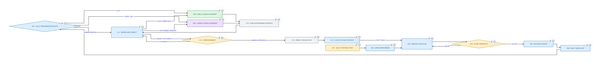
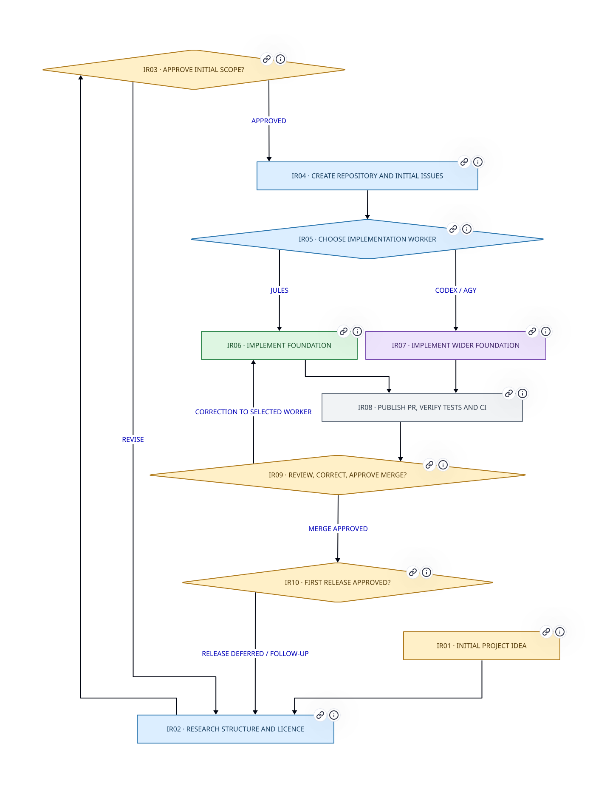
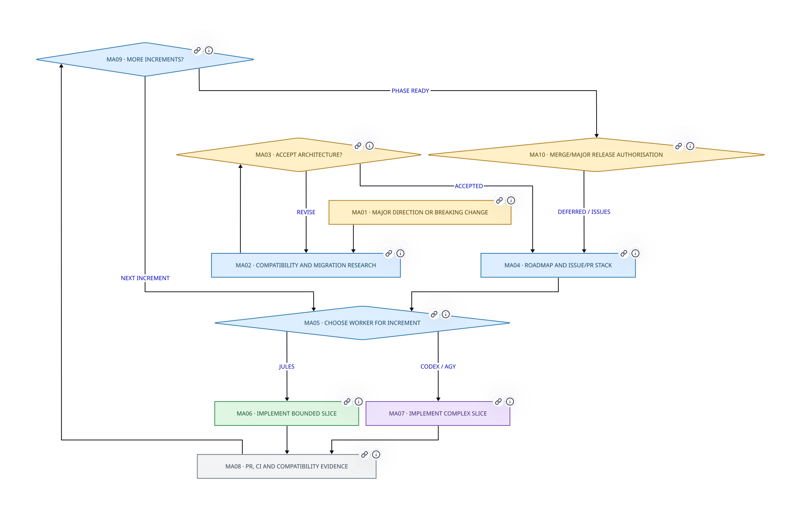
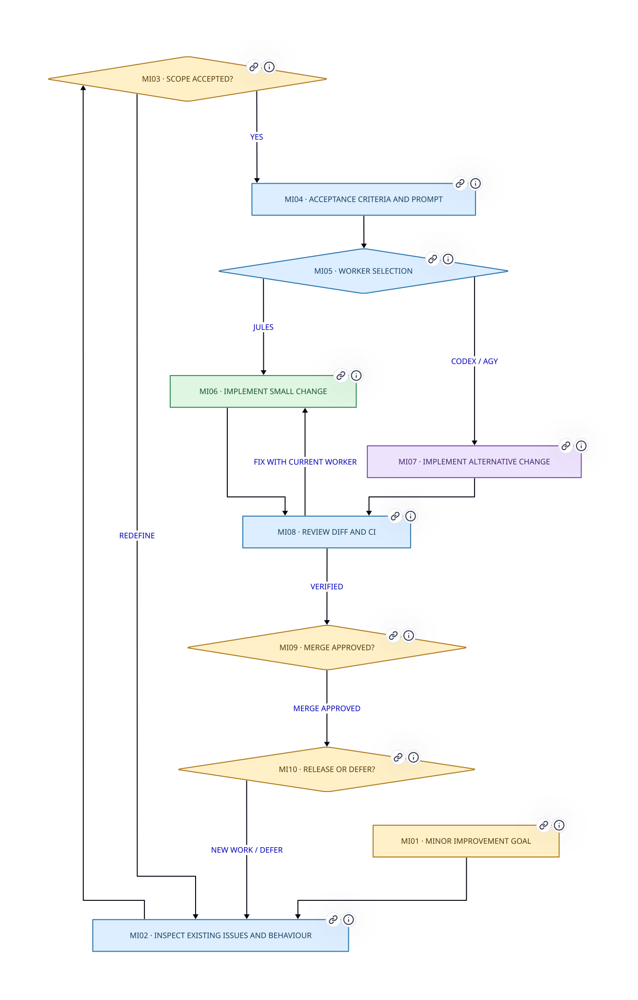
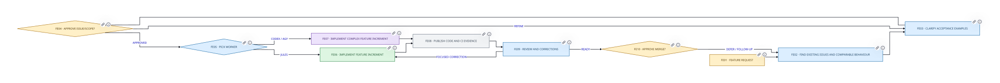
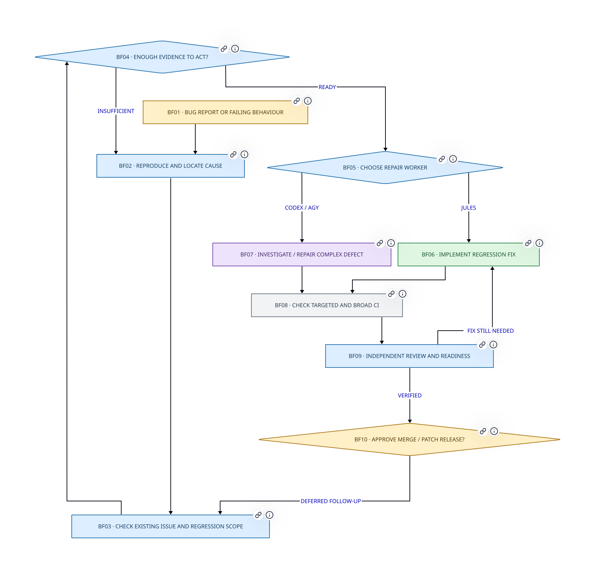
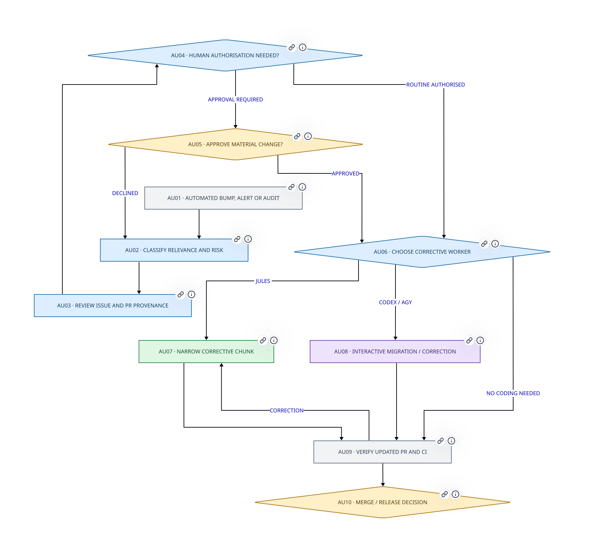
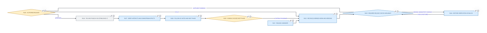
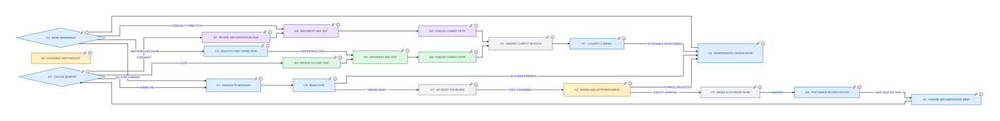
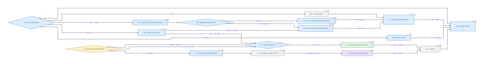

<!-- cspell:words agy bot-authored D2 handoff handoffs inspectable kjules non-actionable PRs workstream workstreams -->

Software development with coding agents is not a straight line from a prompt to a pull request. My process begins with different kinds of work, uses a chat-based management agent to preserve intent and reconcile GitHub state, delegates bounded implementation to an appropriate worker, and loops through review, CI, human decisions and follow-up planning.

This is a **process map** rather than a description of a single Jules task. [Managing Jules with a Management LLM](/blog/post/2026/044-jules-management/) remains the more detailed operating reference for Jules-specific behaviour. This article describes the wider process in which Jules is one optional implementation path. Both articles form complementary current guidance; if they conflict on Jules branch ownership and Ready-for-review administration, follow the detailed Jules management article until the conflict is deliberately resolved.

There is normally **one chat conversation per coherent workstream**, not necessarily one per issue or PR. Several workstreams can run independently at once. Within a workstream, Jules **or** Codex/Agy is ordinarily the selected implementation route for a particular increment; parallel PRs and stacked dependencies are deliberate exceptions, not an accidental consequence of drawing branches next to each other.

## Diagram

The diagrams are written in **D2**, with committed SVG renders. D2 sources are the single point of edit; the `render-diagrams.sh` script regenerates all SVGs. Colours identify the **actor**: amber for human, blue for chat management, green for Jules, violet for Codex/Agy and grey for GitHub/CI. Diamonds denote decisions and labelled arrows define permitted transitions.

[Full-size overview](overview.svg) · [D2 source](overview.d2) · [Overview node descriptions](#overview-nodes)

### Parallel process paths

There are deliberately **separate, similar paths** for each kind of work. This makes the differences in discovery, approvals, CI and publication visible without forcing one enormous diagram. Paths do not mean that implementation workers operate simultaneously; Jules and Codex/Agy are alternative workers for a chosen increment.

#### Initial release

[Open SVG](paths/initial-release.svg) · [Edit D2](paths/initial-release.d2) · [Node descriptions](#route-initial-release-nodes)

#### Major change

[Open SVG](paths/major-change.svg) · [Edit D2](paths/major-change.d2) · [Node descriptions](#route-major-change-nodes)

#### Minor improvement

[Open SVG](paths/minor-change.svg) · [Edit D2](paths/minor-change.d2) · [Node descriptions](#route-minor-change-nodes)

#### Feature implementation

[Open SVG](paths/feature.svg) · [Edit D2](paths/feature.d2) · [Node descriptions](#route-feature-nodes)

#### Bug fix

[Open SVG](paths/bug-fix.svg) · [Edit D2](paths/bug-fix.d2) · [Node descriptions](#route-bug-fix-nodes)

#### Automated maintenance

[Open SVG](paths/automation.svg) · [Edit D2](paths/automation.d2) · [Node descriptions](#route-automation-nodes)

#### Release and publication

[Open SVG](paths/release.svg) · [Edit D2](paths/release.d2) · [Node descriptions](#route-release-nodes)

### Shared subprocess diagrams

#### Planning and issue reconciliation

[Planning SVG](planning.svg) · [D2 source](planning.d2) · [Node descriptions](#planning-and-intake-nodes)

#### Implementation and PR review

[Implementation SVG](implementation.svg) · [D2 source](implementation.d2) · [Node descriptions](#implementation-and-review-nodes). Jules executes focused chunks while the chat agent retains PR metadata, issue state, review and routing. Codex/Agy is an alternative, not a second editor on a Jules branch.

#### CI, quotas and recovery

[CI and recovery SVG](ci-recovery.svg) · [D2 source](ci-recovery.d2) · [Node descriptions](#ci-and-recovery-nodes). Quota-limited or unavailable CI remains missing evidence. A non-required, non-actionable run can be documented and set aside; required checks cannot be treated as passed.

### Rendering and source maintenance

Run `bash render-diagrams.sh` from this article's page bundle with D2 v0.9.0 installed. The script renders all eleven `.d2` files to `.svg`. The PR also includes a renderer workflow intended to update the committed SVGs. Do not edit the SVGs manually. If a diagram changes, its source, SVG and the associated node description must remain consistent.

Each SVG shape links to its stable node anchor in this article. In-page image embedding does not always expose those links, so the adjacent navigation links and node catalogue are provided as alternatives.

## Starting points and scope

| Entry | Distinct planning needs | Full route |
| --- | --- | --- |
| Initial release / repository creation | Project identity, ownership, licensing, first CI and publication | [Initial release](#route-initial-release-nodes) |
| Major improvement | Breaking changes, migration, architecture and staged dependencies | [Major change](#route-major-change-nodes) |
| Minor improvement | Additive behaviour with a bounded scope | [Minor improvement](#route-minor-change-nodes) |
| Feature | User scenarios and acceptance criteria | [Feature](#route-feature-nodes) |
| Bug fix | Reproduction and regression evidence | [Bug fix](#route-bug-fix-nodes) |
| Automated bump, tooling correction or audit | Bot/CI findings, suitability and risk evaluation | [Maintenance](#route-automation-nodes) |
| Release candidate | Reconcile merged work, verify artifacts and explicitly approve publication | [Release](#route-release-nodes) |

A workstream can begin with an existing PR or CI failure, and a single chat may manage several related issues and PRs. Multiple independent chats may progress concurrently. The diagram paths are alternatives for a **work type**, not a claim that all workers run together.

## Agents

| Actor | Responsibilities | Limitations and authority boundaries |
| --- | --- | --- |
| **Human** | Goals, trade-offs, acceptance of significant changes, selecting broad agent handoffs, responding to third-party humans, merge and release decisions | Attention is limited; not expected to do repetitive PR metadata work. Decisions cannot be inferred merely from a passing check. |
| **Chat management agent** | Research, process planning, issue triage, writing agent prompts, independent cumulative-diff review, CI interpretation, PR administration, Ready-for-review transition, closeout | Chat history is **not** the durable tracker. May lack terminal/tests or GitHub permissions; must verify tool results, disclose gaps and not claim actions succeeded when they did not. |
| **Jules** | Asynchronous, focused code/test increments, observable commits and PR changes, follow-up corrections via its supported channel | Sessions can stall or lose state; limited GitHub control-plane administration; not authoritative about test/review correctness. **Do not let another agent push to a Jules-owned implementation branch.** |
| **Codex / Agy** | Interactive or deeper changes, repository-wide exploration, debugging, larger implementation or recovery on an authorised writable branch | Alternative worker, not an automatic escalation; requires human-authorised handoff when changing agents. PR publication is not independent approval. Preserve provenance and branch isolation. |
| **GitHub / CI (system)** | Persistent issues, PRs, commits, review threads, checks, labels, merges, releases and automation signals | CI can be absent, stale, quota-exhausted or infrastructure-failed. A status is evidence, not a decision; a check that did not run is never represented as passing. |

The chat management agent also distinguishes clearly agent-authored GitHub messages from **third-party human** conversations. It may prepare replies, but should not impersonate the repository owner when engaging a real human.

## Parallelism and nested lifecycles

A single workstream can include several GitHub issues, a sequence of PRs, and multiple Jules sessions. Conversely, separate workstreams can proceed in parallel in separate chats and branches. Do not collapse these identities into one status:

- **Workstream:** exploring / planned / executing / awaiting review / closeout / paused.
- **Issue:** proposed / approved / open / in progress / resolved / deferred.
- **Implementation session:** queued / active / stalled / completed / failed setup / superseded.
- **PR:** absent / draft / ready / merged / closed without merge.
- **CI evidence:** pending / passed / actionable failure / infrastructure fault / quota-unavailable / not applicable.

A stopped Jules session does not automatically invalidate a published PR; a merged PR does not necessarily complete a phase; and a code merge is not equivalent to a published release. A chat reassesses the **current GitHub head and state** at each meaningful return, rather than treating earlier prose as the truth.

## CI rules and exceptions

**Pass:** Verify the check applies to the current head and that it covers the intended acceptance evidence. A green check is necessary only where required, and never a substitute for diff review.

**Actionable failure:** Inspect logs and changed paths. Route a small, concrete correction to the current appropriate worker; investigate unrelated or pre-checkout infrastructure failures separately.

**Pending:** Do not infer success or failure. Continue only when the remaining work is independent of the check; use current results before Ready-for-review or merge decisions.

**Quota-limited / disabled / unrelated infrastructure:** Record the exact missing evidence, why it is unavailable, and any replacement verification. On private repositories where CI quotas are exhausted, it can be reasonable to disregard a *non-required, non-actionable CI run* and continue independent manual review. This is **not** a test pass and does not waive required branch protection, mandatory checks, policy or release validation. If verification is required and no permitted equivalent exists, keep the PR blocked or seek a human decision about an allowed recovery route—do not silently mark it verified.

In particular, review technical readiness separately from GitHub's mechanical mergeability, and keep release publication behind an explicit human decision.

## Nodes (all diagrams)

Stable IDs appear in each source and rendered figure. Each section gives the node's **actor**, its operation and its outgoing transitions; branch labels are conditions, not automatic approvals. The detailed Jules article remains authoritative for its own recovery protocol.

### Parallel route nodes {#parallel-route-nodes}

Each route node has its own ID, actor, purpose and outgoing transition. The destinations link to stable anchors rather than depending on image-only navigation.

#### Initial release {#route-initial-release-nodes}

##### IR01 — Initial project idea {#node-ir01}

**Actor:** Human. **Purpose:** Decide purpose and ownership.

**Can move to:** **continue** → [IR02 — Research structure and licence](#node-ir02).

##### IR02 — Research structure and licence {#node-ir02}

**Actor:** Chat management. **Purpose:** Consider repository, product and publishing requirements.

**Can move to:** **continue** → [IR03 — Approve initial scope?](#node-ir03).

##### IR03 — Approve initial scope? {#node-ir03}

**Actor:** Human (decision). **Purpose:** Revise plan if constraints are unresolved.

**Can move to:** **revise** → [IR02 — Research structure and licence](#node-ir02); **approved** → [IR04 — Create repository and initial issues](#node-ir04).

##### IR04 — Create repository and initial issues {#node-ir04}

**Actor:** Chat management. **Purpose:** With authorisation: repository setup, CI, documentation and durable issues.

**Can move to:** **continue** → [IR05 — Choose implementation worker](#node-ir05).

##### IR05 — Choose implementation worker {#node-ir05}

**Actor:** Chat management (decision). **Purpose:** Jules or Codex/Agy; never both writing same branch.

**Can move to:** **Jules** → [IR06 — Implement foundation](#node-ir06); **Codex / Agy** → [IR07 — Implement wider foundation](#node-ir07).

##### IR06 — Implement foundation {#node-ir06}

**Actor:** Jules. **Purpose:** Small chunks; alternative Codex/Agy for broader changes.

**Can move to:** **continue** → [IR08 — Publish PR, verify tests and CI](#node-ir08).

##### IR07 — Implement wider foundation {#node-ir07}

**Actor:** Codex / Agy. **Purpose:** Alternative worker for deeper foundation or setup.

**Can move to:** **continue** → [IR08 — Publish PR, verify tests and CI](#node-ir08).

##### IR08 — Publish PR, verify tests and CI {#node-ir08}

**Actor:** GitHub / CI. **Purpose:** Real code and evidence in GitHub, not agent prose.

**Can move to:** **continue** → [IR09 — Review, correct, approve merge?](#node-ir09).

##### IR09 — Review, correct, approve merge? {#node-ir09}

**Actor:** Human (decision). **Purpose:** Chat manages review and corrections; human owns merge.

**Can move to:** **correction to selected worker** → [IR06 — Implement foundation](#node-ir06); **merge approved** → [IR10 — First release approved?](#node-ir10).

##### IR10 — First release approved? {#node-ir10}

**Actor:** Human (decision). **Purpose:** Release is distinct from merge; explicit human decision.

**Can move to:** **release deferred / follow-up** → [IR02 — Research structure and licence](#node-ir02).

#### Major change {#route-major-change-nodes}

##### MA01 — Major direction or breaking change {#node-ma01}

**Actor:** Human. **Purpose:** Define business/technical objective.

**Can move to:** **continue** → [MA02 — Compatibility and migration research](#node-ma02).

##### MA02 — Compatibility and migration research {#node-ma02}

**Actor:** Chat management. **Purpose:** Affected APIs, dependencies, users and upgrade paths.

**Can move to:** **continue** → [MA03 — Accept architecture?](#node-ma03).

##### MA03 — Accept architecture? {#node-ma03}

**Actor:** Human (decision). **Purpose:** Resolve significant design choices before coding.

**Can move to:** **revise** → [MA02 — Compatibility and migration research](#node-ma02); **accepted** → [MA04 — Roadmap and issue/PR stack](#node-ma04).

##### MA04 — Roadmap and issue/PR stack {#node-ma04}

**Actor:** Chat management. **Purpose:** Represent phases, sequencing and dependencies.

**Can move to:** **continue** → [MA05 — Choose worker for increment](#node-ma05).

##### MA05 — Choose worker for increment {#node-ma05}

**Actor:** Chat management (decision). **Purpose:** Jules for bounded slice, Codex/Agy for broad changes.

**Can move to:** **Jules** → [MA06 — Implement bounded slice](#node-ma06); **Codex / Agy** → [MA07 — Implement complex slice](#node-ma07).

##### MA06 — Implement bounded slice {#node-ma06}

**Actor:** Jules. **Purpose:** Small incremental PR; management tracks related stacks.

**Can move to:** **continue** → [MA08 — PR, CI and compatibility evidence](#node-ma08).

##### MA07 — Implement complex slice {#node-ma07}

**Actor:** Codex / Agy. **Purpose:** Alternative path or authorised handoff.

**Can move to:** **continue** → [MA08 — PR, CI and compatibility evidence](#node-ma08).

##### MA08 — PR, CI and compatibility evidence {#node-ma08}

**Actor:** GitHub / CI. **Purpose:** Check real tests, migrations and stack relationships.

**Can move to:** **continue** → [MA09 — More increments?](#node-ma09).

##### MA09 — More increments? {#node-ma09}

**Actor:** Chat management (decision). **Purpose:** Continue same roadmap or request redesign.

**Can move to:** **next increment** → [MA05 — Choose worker for increment](#node-ma05); **phase ready** → [MA10 — Merge/major release authorisation](#node-ma10).

##### MA10 — Merge/major release authorisation {#node-ma10}

**Actor:** Human (decision). **Purpose:** Human decides merge and later publication.

**Can move to:** **deferred / issues** → [MA04 — Roadmap and issue/PR stack](#node-ma04).

#### Minor improvement {#route-minor-change-nodes}

##### MI01 — Minor improvement goal {#node-mi01}

**Actor:** Human. **Purpose:** Specify additive user-visible outcome.

**Can move to:** **continue** → [MI02 — Inspect existing issues and behaviour](#node-mi02).

##### MI02 — Inspect existing issues and behaviour {#node-mi02}

**Actor:** Chat management. **Purpose:** Prefer reuse over duplicate issues.

**Can move to:** **continue** → [MI03 — Scope accepted?](#node-mi03).

##### MI03 — Scope accepted? {#node-mi03}

**Actor:** Human (decision). **Purpose:** Confirm boundaries when consequential.

**Can move to:** **redefine** → [MI02 — Inspect existing issues and behaviour](#node-mi02); **yes** → [MI04 — Acceptance criteria and prompt](#node-mi04).

##### MI04 — Acceptance criteria and prompt {#node-mi04}

**Actor:** Chat management. **Purpose:** Plan a bounded implementation increment.

**Can move to:** **continue** → [MI05 — Worker selection](#node-mi05).

##### MI05 — Worker selection {#node-mi05}

**Actor:** Chat management (decision). **Purpose:** Choose one worker for this increment.

**Can move to:** **Jules** → [MI06 — Implement small change](#node-mi06); **Codex / Agy** → [MI07 — Implement alternative change](#node-mi07).

##### MI06 — Implement small change {#node-mi06}

**Actor:** Jules. **Purpose:** Narrow code and focused tests.

**Can move to:** **continue** → [MI08 — Review diff and CI](#node-mi08).

##### MI07 — Implement alternative change {#node-mi07}

**Actor:** Codex / Agy. **Purpose:** Complex or interactive alternative.

**Can move to:** **continue** → [MI08 — Review diff and CI](#node-mi08).

##### MI08 — Review diff and CI {#node-mi08}

**Actor:** Chat management. **Purpose:** Classify failures and check issue completion.

**Can move to:** **fix with current worker** → [MI06 — Implement small change](#node-mi06); **verified** → [MI09 — Merge approved?](#node-mi09).

##### MI09 — Merge approved? {#node-mi09}

**Actor:** Human (decision). **Purpose:** Chat handles Ready status; human merges.

**Can move to:** **merge approved** → [MI10 — Release or defer?](#node-mi10).

##### MI10 — Release or defer? {#node-mi10}

**Actor:** Human (decision). **Purpose:** Potential minor release, not automatic.

**Can move to:** **new work / defer** → [MI02 — Inspect existing issues and behaviour](#node-mi02).

#### Feature implementation {#route-feature-nodes}

##### FE01 — Feature request {#node-fe01}

**Actor:** Human. **Purpose:** Describe new capability and value.

**Can move to:** **continue** → [FE02 — Find existing issues and comparable behaviour](#node-fe02).

##### FE02 — Find existing issues and comparable behaviour {#node-fe02}

**Actor:** Chat management. **Purpose:** Identify users, edge cases, documentation.

**Can move to:** **continue** → [FE03 — Clarify acceptance examples](#node-fe03).

##### FE03 — Clarify acceptance examples {#node-fe03}

**Actor:** Chat management. **Purpose:** Scenarios and testable outcomes.

**Can move to:** **continue** → [FE04 — Approve issue/scope?](#node-fe04).

##### FE04 — Approve issue/scope? {#node-fe04}

**Actor:** Human (decision). **Purpose:** Ask before creating new issue or major changing the scope.

**Can move to:** **refine** → [FE03 — Clarify acceptance examples](#node-fe03); **approved** → [FE05 — Pick worker](#node-fe05).

##### FE05 — Pick worker {#node-fe05}

**Actor:** Chat management (decision). **Purpose:** Bounded Jules or alternative Codex/Agy.

**Can move to:** **Jules** → [FE06 — Implement feature increment](#node-fe06); **Codex / Agy** → [FE07 — Implement complex feature increment](#node-fe07).

##### FE06 — Implement feature increment {#node-fe06}

**Actor:** Jules. **Purpose:** Code and tests in short chunks.

**Can move to:** **continue** → [FE08 — Publish code and CI evidence](#node-fe08).

##### FE07 — Implement complex feature increment {#node-fe07}

**Actor:** Codex / Agy. **Purpose:** Alternative worker, not a simultaneous editor.

**Can move to:** **continue** → [FE08 — Publish code and CI evidence](#node-fe08).

##### FE08 — Publish code and CI evidence {#node-fe08}

**Actor:** GitHub / CI. **Purpose:** PR, checks, review threads.

**Can move to:** **continue** → [FE09 — Review and corrections](#node-fe09).

##### FE09 — Review and corrections {#node-fe09}

**Actor:** Chat management. **Purpose:** Independent cumulative-diff review; maintain PR metadata.

**Can move to:** **focused correction** → [FE06 — Implement feature increment](#node-fe06); **ready** → [FE10 — Approve merge?](#node-fe10).

##### FE10 — Approve merge? {#node-fe10}

**Actor:** Human (decision). **Purpose:** Decide final merge; release optional.

**Can move to:** **defer / follow-up** → [FE02 — Find existing issues and comparable behaviour](#node-fe02).

#### Bug fix {#route-bug-fix-nodes}

##### BF01 — Bug report or failing behaviour {#node-bf01}

**Actor:** Human. **Purpose:** Human, third-party or test/monitoring report.

**Can move to:** **continue** → [BF02 — Reproduce and locate cause](#node-bf02).

##### BF02 — Reproduce and locate cause {#node-bf02}

**Actor:** Chat management. **Purpose:** Gather logs, versions, observed vs expected.

**Can move to:** **continue** → [BF03 — Check existing issue and regression scope](#node-bf03).

##### BF03 — Check existing issue and regression scope {#node-bf03}

**Actor:** Chat management. **Purpose:** Maintain durable problem state.

**Can move to:** **continue** → [BF04 — Enough evidence to act?](#node-bf04).

##### BF04 — Enough evidence to act? {#node-bf04}

**Actor:** Chat management (decision). **Purpose:** Request more data instead of guessing.

**Can move to:** **insufficient** → [BF02 — Reproduce and locate cause](#node-bf02); **ready** → [BF05 — Choose repair worker](#node-bf05).

##### BF05 — Choose repair worker {#node-bf05}

**Actor:** Chat management (decision). **Purpose:** Jules small fix or Codex/Agy deeper debugging.

**Can move to:** **Jules** → [BF06 — Implement regression fix](#node-bf06); **Codex / Agy** → [BF07 — Investigate / repair complex defect](#node-bf07).

##### BF06 — Implement regression fix {#node-bf06}

**Actor:** Jules. **Purpose:** Small targeted patch and regression test.

**Can move to:** **continue** → [BF08 — Check targeted and broad CI](#node-bf08).

##### BF07 — Investigate / repair complex defect {#node-bf07}

**Actor:** Codex / Agy. **Purpose:** Alternative investigation route.

**Can move to:** **continue** → [BF08 — Check targeted and broad CI](#node-bf08).

##### BF08 — Check targeted and broad CI {#node-bf08}

**Actor:** GitHub / CI. **Purpose:** Separate actionable failures from quota/infra.

**Can move to:** **continue** → [BF09 — Independent review and readiness](#node-bf09).

##### BF09 — Independent review and readiness {#node-bf09}

**Actor:** Chat management. **Purpose:** Confirm reproduction and intended outcome.

**Can move to:** **fix still needed** → [BF06 — Implement regression fix](#node-bf06); **verified** → [BF10 — Approve merge / patch release?](#node-bf10).

##### BF10 — Approve merge / patch release? {#node-bf10}

**Actor:** Human (decision). **Purpose:** Merge and release are separate decisions.

**Can move to:** **deferred follow-up** → [BF03 — Check existing issue and regression scope](#node-bf03).

#### Automated maintenance {#route-automation-nodes}

##### AU01 — Automated bump, alert or audit {#node-au01}

**Actor:** GitHub / CI. **Purpose:** Dependabot/tooling/CI audit event.

**Can move to:** **continue** → [AU02 — Classify relevance and risk](#node-au02).

##### AU02 — Classify relevance and risk {#node-au02}

**Actor:** Chat management. **Purpose:** Assess affected dependencies, security, compatibility.

**Can move to:** **continue** → [AU03 — Review issue and PR provenance](#node-au03).

##### AU03 — Review issue and PR provenance {#node-au03}

**Actor:** Chat management. **Purpose:** Check agent versus third-party ownership.

**Can move to:** **continue** → [AU04 — Human authorisation needed?](#node-au04).

##### AU04 — Human authorisation needed? {#node-au04}

**Actor:** Chat management (decision). **Purpose:** New issues/major changes or sensitive decisions.

**Can move to:** **routine authorised** → [AU06 — Choose corrective worker](#node-au06); **approval required** → [AU05 — Approve material change?](#node-au05).

##### AU05 — Approve material change? {#node-au05}

**Actor:** Human (decision). **Purpose:** Human retains consequential scope decisions.

**Can move to:** **approved** → [AU06 — Choose corrective worker](#node-au06); **declined** → [AU02 — Classify relevance and risk](#node-au02).

##### AU06 — Choose corrective worker {#node-au06}

**Actor:** Chat management (decision). **Purpose:** Automated update may already have a PR.

**Can move to:** **Jules** → [AU07 — Narrow corrective chunk](#node-au07); **Codex / Agy** → [AU08 — Interactive migration / correction](#node-au08); **no coding needed** → [AU09 — Verify updated PR and CI](#node-au09).

##### AU07 — Narrow corrective chunk {#node-au07}

**Actor:** Jules. **Purpose:** Implement if the bot update needs small fixes.

**Can move to:** **continue** → [AU09 — Verify updated PR and CI](#node-au09).

##### AU08 — Interactive migration / correction {#node-au08}

**Actor:** Codex / Agy. **Purpose:** Alternative for broader failures.

**Can move to:** **continue** → [AU09 — Verify updated PR and CI](#node-au09).

##### AU09 — Verify updated PR and CI {#node-au09}

**Actor:** GitHub / CI. **Purpose:** Do not regard quota-limited CI as passed.

**Can move to:** **continue** → [AU10 — Merge / release decision](#node-au10); **correction** → [AU07 — Narrow corrective chunk](#node-au07).

##### AU10 — Merge / release decision {#node-au10}

**Actor:** Human (decision). **Purpose:** No auto-merge merely because tool generated update.

**Can move to:** The next workstream or subprocess, after the relevant approval.

#### Release and publication {#route-release-nodes}

##### RL01 — Release candidate {#node-rl01}

**Actor:** Chat management. **Purpose:** From first, major, minor, patch or maintenance work.

**Can move to:** **continue** → [RL02 — Reconcile merged work and versions](#node-rl02).

##### RL02 — Reconcile merged work and versions {#node-rl02}

**Actor:** Chat management. **Purpose:** Changelog, compatibility, dependency status.

**Can move to:** **continue** → [RL03 — Required release checks available?](#node-rl03).

##### RL03 — Required release checks available? {#node-rl03}

**Actor:** Chat management (decision). **Purpose:** Classify quotas, failing tests, infrastructure.

**Can move to:** **missing mandatory evidence** → [RL04 — Restore verification or block](#node-rl04); **sufficient evidence** → [RL05 — Authorise release?](#node-rl05).

##### RL04 — Restore verification or block {#node-rl04}

**Actor:** Chat management. **Purpose:** No fabricated pass or branch-protection bypass.

**Can move to:** **checks restored** → [RL03 — Required release checks available?](#node-rl03).

##### RL05 — Authorise release? {#node-rl05}

**Actor:** Human (decision). **Purpose:** Explicit publication decision.

**Can move to:** **hold** → [RL02 — Reconcile merged work and versions](#node-rl02); **approved** → [RL06 — Tag and publish via established CI](#node-rl06).

##### RL06 — Tag and publish via established CI {#node-rl06}

**Actor:** GitHub / CI. **Purpose:** One safe release publisher per tag.

**Can move to:** **continue** → [RL07 — Verify artifacts and downstream effects](#node-rl07).

##### RL07 — Verify artifacts and downstream effects {#node-rl07}

**Actor:** Chat management. **Purpose:** Validate actual release, not only workflow dispatch.

**Can move to:** **continue** → [RL08 — Follow-up, notes and next phase](#node-rl08).

##### RL08 — Follow-up, notes and next phase {#node-rl08}

**Actor:** Chat management. **Purpose:** Reconcile issues and select next work.

**Can move to:** **continue** → [RL09 — Human chooses next phase](#node-rl09).

##### RL09 — Human chooses next phase {#node-rl09}

**Actor:** Human (decision). **Purpose:** Do not silently start new project.

**Can move to:** **continue roadmap** → [RL02 — Reconcile merged work and versions](#node-rl02).

### Overview nodes {#overview-nodes}

#### O01 — Select starting point {#node-o01}

**Actor:** Human. **Action:** New, major, minor, fix or automated. This node records an operation or observed state, not implicit human approval.

**Transitions:** **on completion** → [O02 — Open workstream](#node-o02).

**Boundary:** Selecting initial release includes repository creation and preparation for publication; an automated event can re-enter planning without a new idea.

#### O02 — Open workstream {#node-o02}

**Actor:** Chat management. **Action:** Keep a chat per coherent workstream. This node records an operation or observed state, not implicit human approval.

**Transitions:** **on completion** → [O03 — Research and plan](#node-o03).

#### O03 — Research and plan {#node-o03}

**Actor:** Chat management. **Action:** Inspect repository, issues and releases. This node records an operation or observed state, not implicit human approval.

**Transitions:** **on completion** → [O04 — Accept approach?](#node-o04).

#### O04 — Accept approach? {#node-o04}

**Actor:** Human. **Action:** Scope, priority and dependencies. This is a decision gate; the labelled outcomes determine the next operation.

**Transitions:** **revise** → [O03 — Research and plan](#node-o03); **accept** → [O05 — Reconcile issues](#node-o05).

**Boundary:** The human may iterate collaboratively rather than approving a preselected option.

#### O05 — Reconcile issues {#node-o05}

**Actor:** Chat management. **Action:** Prepare existing or proposed records. This node records an operation or observed state, not implicit human approval.

**Transitions:** **on completion** → [O06 — Select work unit](#node-o06).

#### O06 — Select work unit {#node-o06}

**Actor:** Chat management. **Action:** One or several related issues. This node records an operation or observed state, not implicit human approval.

**Transitions:** **on completion** → [O07 — Select implementation path](#node-o07).

#### O07 — Select implementation path {#node-o07}

**Actor:** Chat management. **Action:** Jules / Codex-Agy / chat admin. This is a decision gate; the labelled outcomes determine the next operation.

**Transitions:** **Jules** → [O08 — Small coding increment](#node-o08); **Codex/Agy** → [O09 — Larger coding increment](#node-o09); **administration only** → [O11 — Review and correct](#node-o11).

**Boundary:** Jules and Codex/Agy paths are alternatives for this increment, not parallel agents writing to the same branch.

#### O08 — Small coding increment {#node-o08}

**Actor:** Jules. **Action:** Focused prompt and asynchronous changes. This node records an operation or observed state, not implicit human approval.

**Transitions:** **on completion** → [O10 — Publish reviewable evidence](#node-o10).

#### O09 — Larger coding increment {#node-o09}

**Actor:** Codex / Agy. **Action:** Interactive or recovery execution. This node records an operation or observed state, not implicit human approval.

**Transitions:** **on completion** → [O10 — Publish reviewable evidence](#node-o10).

#### O10 — Publish reviewable evidence {#node-o10}

**Actor:** GitHub / CI. **Action:** PR, commits, tests and CI. This node records an operation or observed state, not implicit human approval.

**Transitions:** **on completion** → [O11 — Review and correct](#node-o11).

#### O11 — Review and correct {#node-o11}

**Actor:** Chat management. **Action:** Diff, CI, issues, metadata, loops. This node records an operation or observed state, not implicit human approval.

**Transitions:** **another Jules chunk** → [O08 — Small coding increment](#node-o08); **coding/recovery** → [O09 — Larger coding increment](#node-o09); **ready** → [O12 — Approve merge?](#node-o12).

**Boundary:** Subprocess details: [implementation](#implementation-and-review-nodes) and [CI/recovery](#ci-and-recovery-nodes).

#### O12 — Approve merge? {#node-o12}

**Actor:** Human. **Action:** Human reviews the ready PR. This is a decision gate; the labelled outcomes determine the next operation.

**Transitions:** **request changes** → [O11 — Review and correct](#node-o11); **approved** → [O13 — Merge / release gate](#node-o13).

**Boundary:** Ready for review does not grant merge authority.

#### O13 — Merge / release gate {#node-o13}

**Actor:** GitHub / CI. **Action:** Merge authorised; publish separately. This node records an operation or observed state, not implicit human approval.

**Transitions:** **on completion** → [O14 — Close out and continue](#node-o14).

#### O14 — Close out and continue {#node-o14}

**Actor:** Chat management. **Action:** Reconcile issues, release and next phase. This node records an operation or observed state, not implicit human approval.

**Transitions:** **next phase** → [O03 — Research and plan](#node-o03).

### Planning and intake nodes {#planning-and-intake-nodes}

#### P01 — Identify entry point {#node-p01}

**Actor:** Human. **Action:** Initial, major, minor, fix, automation. This node records an operation or observed state, not implicit human approval.

**Transitions:** **on completion** → [P02 — Establish workstream](#node-p02).

**Boundary:** For first release, include repository initialisation and initial CI; for version bumps, inspect bot-created PRs and security/audit impact.

#### P02 — Establish workstream {#node-p02}

**Actor:** Chat management. **Action:** One chat per workstream, parallel chats OK. This node records an operation or observed state, not implicit human approval.

**Transitions:** **on completion** → [P03 — Discover baseline](#node-p03).

#### P03 — Discover baseline {#node-p03}

**Actor:** Chat management. **Action:** Source, open issues, PRs, CI, releases. This node records an operation or observed state, not implicit human approval.

**Transitions:** **on completion** → [P04 — Research alternatives](#node-p04).

#### P04 — Research alternatives {#node-p04}

**Actor:** Chat management. **Action:** Trade-offs, compatibility and risks. This node records an operation or observed state, not implicit human approval.

**Transitions:** **on completion** → [P05 — Clarify requirements](#node-p05).

#### P05 — Clarify requirements {#node-p05}

**Actor:** Human. **Action:** Collaborative questions and direction. This node records an operation or observed state, not implicit human approval.

**Transitions:** **refine** → [P04 — Research alternatives](#node-p04); **aligned** → [P06 — Build roadmap](#node-p06).

**Boundary:** Human Q&A is collaborative input, not merely an authorisation button.

#### P06 — Build roadmap {#node-p06}

**Actor:** Chat management. **Action:** Dependencies, stages and release intent. This node records an operation or observed state, not implicit human approval.

**Transitions:** **on completion** → [P07 — Approve roadmap?](#node-p07).

#### P07 — Approve roadmap? {#node-p07}

**Actor:** Human. **Action:** Direction / costs / non-goals. This is a decision gate; the labelled outcomes determine the next operation.

**Transitions:** **rework** → [P04 — Research alternatives](#node-p04); **accepted** → [P08 — Reconcile issue register](#node-p08).

#### P08 — Reconcile issue register {#node-p08}

**Actor:** Chat management. **Action:** Deduplicate, refine and draft candidates. This node records an operation or observed state, not implicit human approval.

**Transitions:** **new issues found** → [P09 — Create new issues?](#node-p09).

#### P09 — Create new issues? {#node-p09}

**Actor:** Human. **Action:** Explicit approval for new records. This is a decision gate; the labelled outcomes determine the next operation.

**Transitions:** **yes** → [P10 — Record durable issues](#node-p10); **no / existing** → [P11 — Choose implementation unit](#node-p11).

**Boundary:** New issue creation requires explicit human authorisation; maintaining accurate existing issues is routine management.

#### P10 — Record durable issues {#node-p10}

**Actor:** GitHub / CI. **Action:** Create only approved; update existing. This node records an operation or observed state, not implicit human approval.

**Transitions:** **on completion** → [P11 — Choose implementation unit](#node-p11).

#### P11 — Choose implementation unit {#node-p11}

**Actor:** Chat management. **Action:** Cluster related issues, scope PRs. This node records an operation or observed state, not implicit human approval.

**Transitions:** **on completion** → [P12 — Set acceptance evidence](#node-p12).

**Boundary:** A work unit can resolve multiple related issues or need stacked PRs, but should not collect unrelated work.

#### P12 — Set acceptance evidence {#node-p12}

**Actor:** Chat management. **Action:** Tests, CI, documentation and rollback. This node records an operation or observed state, not implicit human approval.

**Transitions:** **on completion** → [P13 — Authorize execution](#node-p13).

#### P13 — Authorize execution {#node-p13}

**Actor:** Human. **Action:** Agent handoff when required. This node records an operation or observed state, not implicit human approval.

**Transitions:** **restart as new workstream** → [P02 — Establish workstream](#node-p02).

**Boundary:** Approval to implement does not authorise a merge or a release.

### Implementation and review nodes {#implementation-and-review-nodes}

#### I01 — Prepare implementation brief {#node-i01}

**Actor:** Chat management. **Action:** Current head, acceptance and test plan. This node records an operation or observed state, not implicit human approval.

**Transitions:** **on completion** → [I02 — Choose worker?](#node-i02).

#### I02 — Choose worker? {#node-i02}

**Actor:** Chat management. **Action:** Exclusive primary implementation path. This is a decision gate; the labelled outcomes determine the next operation.

**Transitions:** **Jules** → [I04 — Receive focused task](#node-i04); **Codex/Agy** → [I07 — Receive implementation task](#node-i07); **admin only** → [I15 — Manage PR metadata](#node-i15).

**Boundary:** Choose one primary implementation worker for the next increment. Change worker only by an explicit, safe handoff.

#### I03 — Authorize new handoff {#node-i03}

**Actor:** Human. **Action:** Required for changing implementation agent. This node records an operation or observed state, not implicit human approval.

**Transitions:** Terminal for this diagram; consult the next subprocess or management review.

**Boundary:** The workstream can remain paused pending human authorisation; the diagram does not imply automatic escalation.

#### I04 — Receive focused task {#node-i04}

**Actor:** Jules. **Action:** Concrete, bounded chunk. This node records an operation or observed state, not implicit human approval.

**Transitions:** **on completion** → [I05 — Implement and test](#node-i05).

#### I05 — Implement and test {#node-i05}

**Actor:** Jules. **Action:** Asynchronous coding, limited admin. This node records an operation or observed state, not implicit human approval.

**Transitions:** **on completion** → [I06 — Publish commit or PR](#node-i06).

#### I06 — Publish commit or PR {#node-i06}

**Actor:** Jules. **Action:** Observable GitHub changes. This node records an operation or observed state, not implicit human approval.

**Transitions:** **on completion** → [I10 — Observe current revision](#node-i10).

**Boundary:** A Jules message that says completed is not equivalent to an inspectable commit or PR.

#### I07 — Receive implementation task {#node-i07}

**Actor:** Codex / Agy. **Action:** Writable branch and relevant context. This node records an operation or observed state, not implicit human approval.

**Transitions:** **on completion** → [I08 — Implement and test](#node-i08).

#### I08 — Implement and test {#node-i08}

**Actor:** Codex / Agy. **Action:** Larger change or deeper debugging. This node records an operation or observed state, not implicit human approval.

**Transitions:** **on completion** → [I09 — Publish commit or PR](#node-i09).

#### I09 — Publish commit or PR {#node-i09}

**Actor:** Codex / Agy. **Action:** Independent branch or safe current PR. This node records an operation or observed state, not implicit human approval.

**Transitions:** **on completion** → [I10 — Observe current revision](#node-i10).

#### I10 — Observe current revision {#node-i10}

**Actor:** GitHub / CI. **Action:** Head SHA, diff, comments and checks. This node records an operation or observed state, not implicit human approval.

**Transitions:** **on completion** → [I11 — Classify CI signal](#node-i11).

**Boundary:** Check the actual new head and its entire cumulative diff; do not accept a summary as proof.

#### I11 — Classify CI signal {#node-i11}

**Actor:** Chat management. **Action:** See separate CI subprocess. This node records an operation or observed state, not implicit human approval.

**Transitions:** **actionable or recorded** → [I12 — Independently review work](#node-i12).

**Boundary:** Quota-limited checks go through [C07](#node-c07), not a fictional pass.

#### I12 — Independently review work {#node-i12}

**Actor:** Chat management. **Action:** Cumulative diff, tests and requirements. This node records an operation or observed state, not implicit human approval.

**Transitions:** **on completion** → [I13 — Work remaining?](#node-i13).

#### I13 — Work remaining? {#node-i13}

**Actor:** Chat management. **Action:** Defect, administration or complete. This is a decision gate; the labelled outcomes determine the next operation.

**Transitions:** **another Jules chunk** → [I14 — Issue focused correction](#node-i14); **Codex/Agy correction** → [I08 — Implement and test](#node-i08); **no code changes** → [I15 — Manage PR metadata](#node-i15).

**Boundary:** A tiny direct fix may be management-owned only on a safe management branch; broader fixes require a worker.

#### I14 — Issue focused correction {#node-i14}

**Actor:** Chat management. **Action:** Fresh @jules comment where appropriate. This node records an operation or observed state, not implicit human approval.

**Transitions:** **new instruction** → [I05 — Implement and test](#node-i05).

**Boundary:** Post a fresh focused @jules comment when its integration is active and correction is reasonable; avoid zero-diff loops.

#### I15 — Manage PR metadata {#node-i15}

**Actor:** Chat management. **Action:** Description, links, labels and draft state. This node records an operation or observed state, not implicit human approval.

**Transitions:** **on completion** → [I16 — Ready gate](#node-i16).

#### I16 — Ready gate {#node-i16}

**Actor:** Chat management. **Action:** Latest head verified; disclose CI gaps. This node records an operation or observed state, not implicit human approval.

**Transitions:** **blocking evidence** → [I12 — Independently review work](#node-i12); **verified ready** → [I17 — Set Ready for review](#node-i17).

**Boundary:** Required verification must be real. A non-required quota-limited run may be documented and excluded from readiness only when policy permits.

#### I17 — Set Ready for review {#node-i17}

**Actor:** GitHub / CI. **Action:** Confirm actual draft-to-ready transition. This node records an operation or observed state, not implicit human approval.

**Transitions:** **state confirmed** → [I18 — Review and authorise merge](#node-i18).

**Boundary:** After verification, perform and confirm GitHub Ready-for-review transition during the same review pass.

#### I18 — Review and authorise merge {#node-i18}

**Actor:** Human. **Action:** Human-owned decision. This node records an operation or observed state, not implicit human approval.

**Transitions:** **changes requested** → [I12 — Independently review work](#node-i12); **explicit approval** → [I19 — Merge authorised work](#node-i19).

**Boundary:** Only an explicit human instruction permits merge; change requests return to management review.

#### I19 — Merge authorised work {#node-i19}

**Actor:** GitHub / CI. **Action:** Never infer approval from CI. This node records an operation or observed state, not implicit human approval.

**Transitions:** **merged** → [I20 — Post-merge reconciliation](#node-i20).

#### I20 — Post-merge reconciliation {#node-i20}

**Actor:** Chat management. **Action:** Issues, follow-ups and next task. This node records an operation or observed state, not implicit human approval.

**Transitions:** **next selected task** → [I01 — Prepare implementation brief](#node-i01).

**Boundary:** Assess release suitability but do not automatically publish. Prefer next eligible work in the same repository.

### CI and recovery nodes {#ci-and-recovery-nodes}

#### C01 — CI event {#node-c01}

**Actor:** GitHub / CI. **Action:** Push, PR, dispatch or scheduled run. This node records an operation or observed state, not implicit human approval.

**Transitions:** **on completion** → [C02 — Classify signal](#node-c02).

#### C02 — Classify signal {#node-c02}

**Actor:** Chat management. **Action:** Required? relevant? current head?. This node records an operation or observed state, not implicit human approval.

**Transitions:** **on completion** → [C03 — Result category?](#node-c03).

**Boundary:** Always classify against the current PR head, test requirements, repository visibility and branch policy.

#### C03 — Result category? {#node-c03}

**Actor:** Chat management. **Action:** Pass / fail / pending / quota. This is a decision gate; the labelled outcomes determine the next operation.

**Transitions:** **pass** → [C04 — Checks passed](#node-c04); **failure** → [C05 — Inspect failed job](#node-c05); **pending** → [C06 — Pending check](#node-c06); **quota / infra** → [C07 — Quota-limited or unavailable](#node-c07).

#### C04 — Checks passed {#node-c04}

**Actor:** GitHub / CI. **Action:** Evidence only for tested revision. This node records an operation or observed state, not implicit human approval.

**Transitions:** **on completion** → [C17 — Re-review current head](#node-c17).

**Boundary:** A stale green check from an earlier head is not conclusive.

#### C05 — Inspect failed job {#node-c05}

**Actor:** Chat management. **Action:** Distinguish code defect and infrastructure. This node records an operation or observed state, not implicit human approval.

**Transitions:** **real code defect** → [C11 — Code correction?](#node-c11); **unrelated infra** → [C09 — Record documented exception](#node-c09).

#### C06 — Pending check {#node-c06}

**Actor:** Chat management. **Action:** Wait for observable result; do not assume. This node records an operation or observed state, not implicit human approval.

**Transitions:** **result available** → [C02 — Classify signal](#node-c02).

#### C07 — Quota-limited or unavailable {#node-c07}

**Actor:** Chat management. **Action:** Identify repo policy and check criticality. This node records an operation or observed state, not implicit human approval.

**Transitions:** **on completion** → [C08 — Required verification?](#node-c08).

**Boundary:** A private-repository quota failure can be expected; record it as unavailable evidence, not product failure.

#### C08 — Required verification? {#node-c08}

**Actor:** Chat management. **Action:** Cannot waive branch protection. This is a decision gate; the labelled outcomes determine the next operation.

**Transitions:** **non-required** → [C09 — Record documented exception](#node-c09); **required** → [C10 — Block or request alternate proof](#node-c10).

**Boundary:** Mandatory checks and branch protections remain binding; management cannot wave them away.

#### C09 — Record documented exception {#node-c09}

**Actor:** Chat management. **Action:** No claim of CI pass; manual evidence. This node records an operation or observed state, not implicit human approval.

**Transitions:** **disclosed** → [C17 — Re-review current head](#node-c17).

**Boundary:** If the check is non-required, record the exemption, manual tests and limitations, then continue independent review.

#### C10 — Block or request alternate proof {#node-c10}

**Actor:** Chat management. **Action:** Rerun, local tests or human decision. This node records an operation or observed state, not implicit human approval.

**Transitions:** **after evidence** → [C17 — Re-review current head](#node-c17).

**Boundary:** When a check is required, seek an authorised alternate check/rerun or hold.

#### C11 — Code correction? {#node-c11}

**Actor:** Chat management. **Action:** Route to current suitable worker. This is a decision gate; the labelled outcomes determine the next operation.

**Transitions:** **Jules suited** → [C12 — Focused corrective chunk](#node-c12); **handoff advised** → [C13 — Approve worker handoff?](#node-c13).

#### C12 — Focused corrective chunk {#node-c12}

**Actor:** Jules. **Action:** Only if session healthy and converging. This node records an operation or observed state, not implicit human approval.

**Transitions:** **new commit** → [C01 — CI event](#node-c01).

**Boundary:** A failed Jules environment before checkout does not count as a coding failure.

#### C13 — Approve worker handoff? {#node-c13}

**Actor:** Human. **Action:** Jules -> Codex/Agy only if authorised. This is a decision gate; the labelled outcomes determine the next operation.

**Transitions:** **yes / Jules-owned** → [C14 — Create replacement branch](#node-c14); **no / retry or hold** → [C11 — Code correction?](#node-c11).

**Boundary:** When Jules is unsuitable, suggest a different worker; the human chooses the handoff.

#### C14 — Create replacement branch {#node-c14}

**Actor:** Chat management. **Action:** Never modify Jules-owned branch. This node records an operation or observed state, not implicit human approval.

**Transitions:** **on completion** → [C15 — Open replacement draft PR](#node-c15).

**Boundary:** If leaving a Jules-owned branch, management creates a separate replacement branch first, from a trusted base.

#### C15 — Open replacement draft PR {#node-c15}

**Actor:** GitHub / CI. **Action:** Cross-link provenance and dependencies. This node records an operation or observed state, not implicit human approval.

**Transitions:** **new writable target** → [C16 — Continue on new branch](#node-c16).

**Boundary:** Open and cross-link the replacement draft PR before providing the new writable target to Codex/Agy.

#### C16 — Continue on new branch {#node-c16}

**Actor:** Codex / Agy. **Action:** Use old Jules work as read-only context. This node records an operation or observed state, not implicit human approval.

**Transitions:** **new commit** → [C01 — CI event](#node-c01).

**Boundary:** Never ask the incoming agent to push directly to the existing Jules branch.

#### C17 — Re-review current head {#node-c17}

**Actor:** Chat management. **Action:** Diff, CI state, issues and readiness. This node records an operation or observed state, not implicit human approval.

**Transitions:** **new CI event** → [C02 — Classify signal](#node-c02).

## Notes and unresolved design questions

This is a **draft process description**, deliberately covering more than the older Jules management post. The original sketches also hint at research/Q&A feedback, issue-stack planning, UI/prototype iteration and multiple simultaneous projects. The four diagrams specify the coding and management routes first; design/prototype and multi-repository orchestration could become separate subprocesses once their transition rules are agreed.

Decisions to refine before publishing:

1. **Human authorisation granularity:** Is a project-level instruction enough to create later related issues, or should every new issue still need its own confirmation? The current diagram retains the Jules article's per-issue approval default.
2. **Release ownership:** Should the chat agent execute a release after an explicit approval, or should the human perform publication personally? In either case, the action is never inferred from PR merge.
3. **Planning/prototyping:** Should UI sketches, throwaway proofs of concept and comparative implementation trials have their own path before durable issue/PR work?
4. **CI exceptions:** Which repositories have non-required checks that are normally ignored due to quotas, and how should that policy be recorded rather than rediscovered each time?
5. **Parallel increments:** When is it worth deliberately maintaining stacked PRs or more than one implementation worker under one workstream, versus opening another management chat?

### Diagram maintenance

- **Primary editable format:** D2 (`*.dot`). Diagram boxes carry stable IDs, actor group and short descriptive text.
- **Committed outputs:** SVG (`*.svg`) alongside each DOT file. No generated bitmap diagrams are necessary.
- **Rendering:** D2 `dot` using [render-diagrams.sh](render-diagrams.sh). Review SVG layout and link targets after edits.
- **Traceability:** When a diagram node is added, renamed or removed, update this catalogue and every incoming/outgoing transition. Keep links and labels aligned.
- **Validation:** Check DOT parses, SVG assets are regenerated, anchors resolve, links remain local, and Hugo front matter and cspell checks succeed.

## References

- [Managing Jules with a Management LLM](/blog/post/2026/044-jules-management/) — current detailed control-plane, branch ownership, review and Ready-for-review rules.
- [ChatGPT-Orchestrated Jules to Agy or Codex](/blog/post/2026/038-jules-agy-codex-handoff/) — historical handoff rationale; defer to newer guidance where inconsistent.
- [Canonical GitHub Actions CI/CD Super-Reference](/blog/post/2026/043-canonical-github-actions-ci-cd-super-reference/) — CI and release engineering policy in repositories where it applies.
- [D2 language](https://graphviz.org/doc/info/lang.html) — diagram source grammar.
- [D2 SVG output](https://graphviz.org/docs/outputs/svg/) — published vector representation.

- [D2 documentation](https://d2lang.com/), including layout and renderer options.
